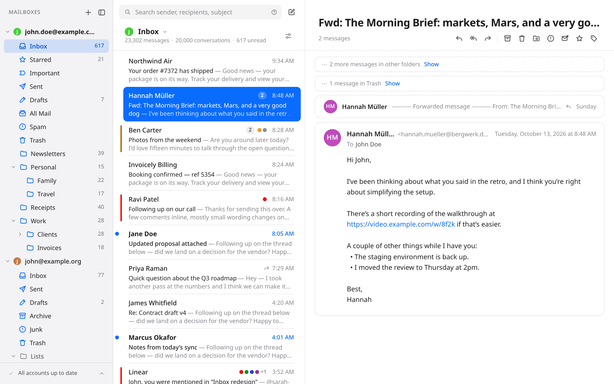
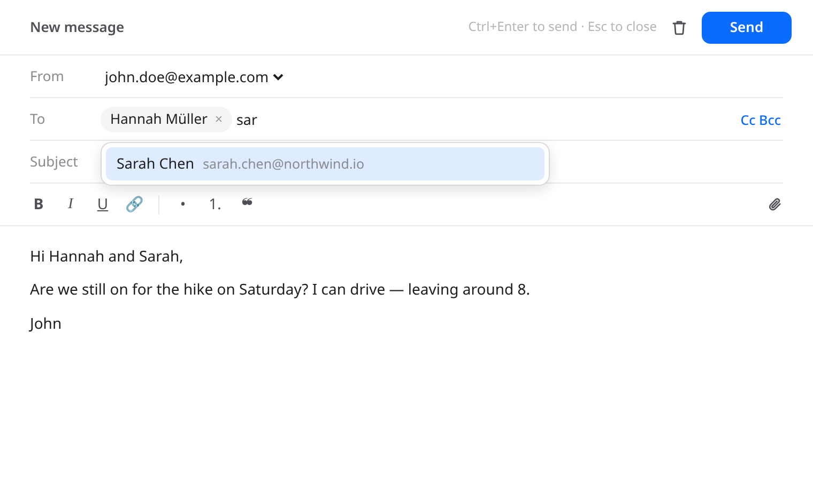
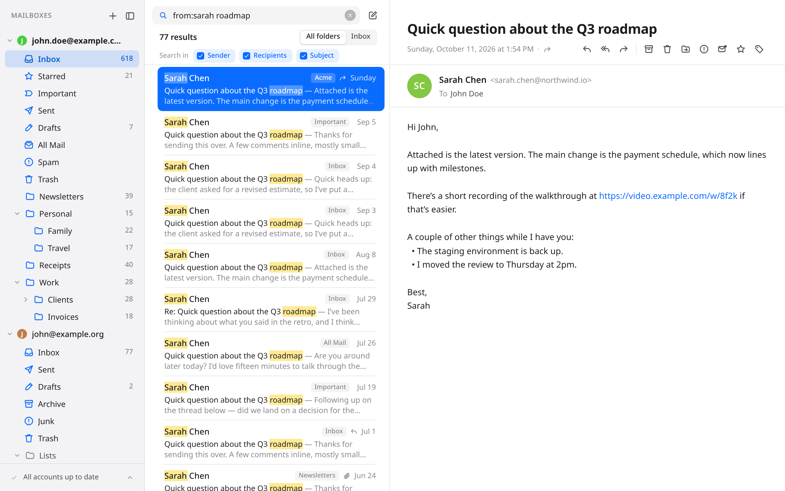
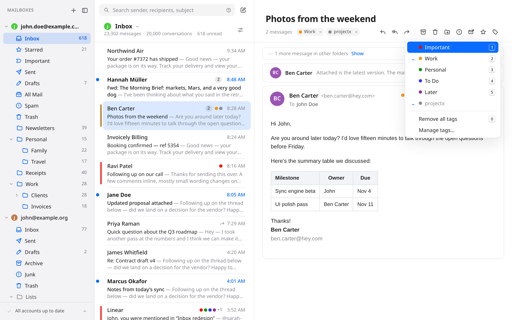
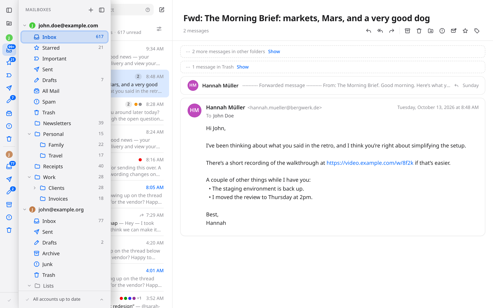
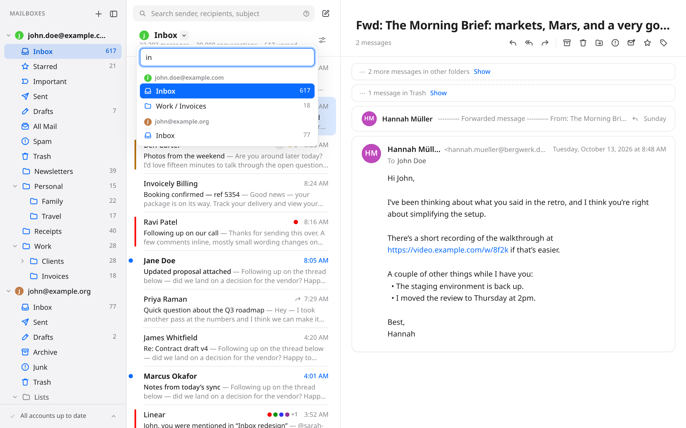
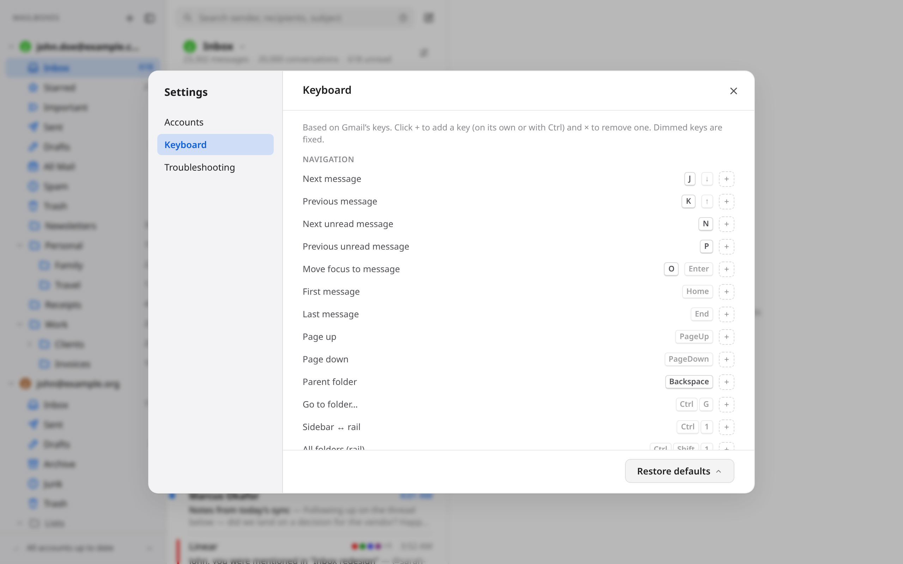
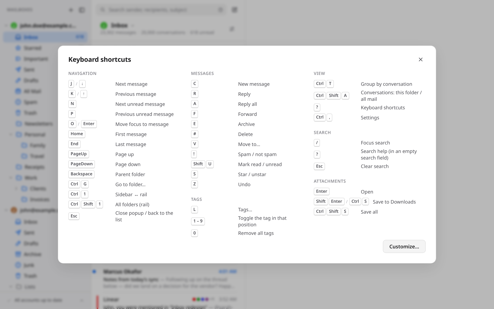

# Email

A fast, local-first desktop email client for Linux and macOS: a Rust core (IMAP sync, SQLite cache, MIME) behind a Tauri v2 + SolidJS UI.

<picture>
  <source media="(prefers-color-scheme: dark)" srcset="docs/screenshots/inbox-dark.png">
  
</picture>

## A quick tour

**Every account in one window.** Gmail (labels included) and any IMAP server, side by side. Mail is kept locally, so the list scrolls through tens of thousands of messages at once and opening one is instant; new mail arrives by IMAP IDLE. Conversations are grouped by their headers, across folders.

**Writing mail** happens in its own window, one per draft: rich text, replies quoted below your text, attachments by picker or drag and drop, and addresses suggested from the people you write to most. Sending waits 10 seconds so you can undo it.



**Search** as you type over senders, recipients and subjects, in every folder or just this one, with `from:`, `to:`, `subject:`, `"phrases"` and `-exclusions`.



**Tags** are Thunderbird's: IMAP keywords that sync with Thunderbird and other clients, toggled with `1`–`9`, shown as dots in the list and chips in the reader.



**Getting around:** the sidebar folds into a rail (Ctrl/⌘+1) whose folders slide out over the list, and Ctrl/⌘+G jumps to any folder of any account by name.




**Keyboard first.** Choose Gmail's or Thunderbird's keys in Settings and change any of them; `?` shows them all.




The screenshots come from the browser preview's demo data (`npm run screenshots`, below), so they're regenerated as the app changes.

```
crates/mail-core   sync engine, storage, MIME parsing/sanitizing — no UI dependencies
crates/mail-cli    `mailsync`: headless benchmark driver for sync strategies
app/               SolidJS UI (app/src) + Tauri shell (app/src-tauri)
```

## Run

```sh
cd app
npm install
npm run tauri dev        # desktop app
npm run dev              # UI only, in a browser, against an in-memory mock backend
npm run screenshots      # regenerate docs/screenshots/ (needs Google Chrome)
```

Gmail currently signs in with an [app password](https://myaccount.google.com/apppasswords) (requires 2-Step Verification). Google Workspace and Microsoft 365 custom domains are detected from the domain's MX records. Passwords are kept in the system keychain (Secret Service on Linux, Keychain on macOS); if the server rejects one, the account's sync pauses and the sidebar asks for a new one.

The browser mock takes URL flags: `?empty` (onboarding), `?auth` (rejected password), `?limited` (connection limit), `?error` (sync error), `?many` (six accounts), `?demo` (no test samples, already synced: what the screenshots use); they can be combined.

`npm run screenshots [name]` serves the preview with `?demo`, pins the clock, time zone and window size, and saves each scene in `app/scripts/screenshots.js` to `docs/screenshots/` (unchanged UI, unchanged files). Add a scene there for a new feature, and reference its image here.

Data lives in `~/.local/share/dev.mailclient.desktop/` on Linux (`~/Library/Application Support/dev.mailclient.desktop/` on macOS): `mail.db` (accounts, folders, headers, threads, search index) and `bodies.db` (raw messages). Window size is in `~/.config/dev.mailclient.desktop/window.json`.

## Features

- **Conversations:** grouped by Message-ID / In-Reply-To / References (no subject matching), across folders. Only `<…>`-delimited ids count (encoded-word ids are decoded; prose and ids that are really addresses are ignored), so damaged headers can't glue unrelated conversations together. By default a conversation shows only the current folder's messages; the View menu in the message list switches the app-wide default to *All mail* and/or *Include Trash*, and each conversation offers a temporary "Show N more messages in other folders / in Trash".
- **Writing mail:** New message, Reply, Reply all and Forward open a compose window per draft (its size remembered). Rich text (bold, italic, underline, links, lists, quotes); replies and forwards put your text above the original (Gmail-style quote, the original's attachments carried along on a forward). Recipients are chips: suggestions come from everyone you've corresponded with, ranked by how often and how recently you wrote to them; a chip can be clicked to edit in place. Attachments come from the file picker or drag and drop (Gmail's 25 MB limit is checked before sending). Drafts are saved as you type and listed in Drafts; closing asks whether to keep or discard. Sending queues the message for 10 s ("Sending… Undo" brings it back into a window), then goes out over SMTP (`lettre`, the server worked out from the IMAP host: Gmail, Microsoft 365, iCloud, Fastmail, Yahoo; same password). The message shows in Sent at once, marked as sending, and the server's copy replaces it; the original is marked replied/forwarded (arrows in the list) (`crates/mail-core/src/compose.rs`, `smtp.rs`).
- **Keyboard:** Settings › Keyboard starts from Gmail's or Thunderbird's keys ("Restore defaults" picks which). Each preset uses only that client's keys for the commands both have; commands only one of them (or neither) has get the same key in both. Any key can be added or removed, including ⌘/Ctrl combinations (except those the system or app needs). Enter moves the keyboard into the open message so the arrows scroll it; Esc goes back to the list. One list (`app/src/lib/shortcuts.ts`) drives the handlers, Settings, button tooltips and the `?` sheet.
- **Help:** `?` (outside text fields) opens the keyboard-shortcuts sheet (also View menu, and Help → Keyboard Shortcuts on macOS). `?` in an empty search field, or its `?` icon, shows the search syntax with clickable examples.
- **Settings** (Ctrl/⌘+,): Accounts (address, servers, password status), Keyboard, and Troubleshooting (version, the log file, the data folder; Developer Tools in builds that include them).
- **Quick search** (`/` with Gmail's keys, Ctrl/⌘+K with Thunderbird's): SQLite FTS5 over sender, recipients and subject, prefix-matched as you type. Syntax: `"phrase"`, `from:`, `to:`, `subject:`, `-exclude`. Scope is the whole account or the current folder; Sender / Recipients / Subject chips limit plain words.
- **Reader:** sanitized HTML in a sandboxed iframe; remote images blocked until "Load images", which is remembered per message. Opening a message marks it read. `format=flowed` plain text is reflowed (RFC 3676). Quoted replies get a bar per level (HTML `blockquote` and plain-text `>` lines alike). Trailing quoted history collapses behind "Show quoted text" only when it's safe: exactly one quote, nothing written after it, text before it, and no Outlook-style history in the message itself — inline and bottom-posted replies never collapse (`app/src/lib/quotes.ts`; `node app/scripts/quotes-selfcheck.js` checks the plain-text rules).
- **Attachments:** a compact pill in each message header (`📎 N · size`): with one attachment, click to open in the default app and ⤓ to save; with several, click for a list with per-file Open/Save and ⤓ to save all. Files go straight into Downloads (`name (1).ext` if taken), with "Show in folder". Attachments left out of the body download are fetched on demand (just that MIME part, on the interactive connection) and cached in `bodies.db`. Executable and script types are saved but never opened directly; file names are sanitized.
- **Message actions:** Archive, Delete, Move to…, Spam/Not spam, Mark read/unread, Star, Tag and Undo, from the keyboard, the reader header (all messages being viewed) or per message in a conversation card. After archiving/deleting, the next older item opens; Undo puts the message back and selects it again. Changes apply locally at once and go to the server through a persistent outbox; moves wait 5 s so Undo just cancels them, and sync waits for pending actions so nothing reappears. Gmail: archive removes `\Inbox` and user labels (unfiled; from Trash/Spam it moves back to All Mail), delete moves to `[Gmail]/Trash` (where the message keeps its labels but shows under none of them), move swaps labels. Other servers: `UID MOVE` to the `\Archive`/`\Trash`/`\Junk` folder (COPY + `\Deleted` without MOVE). A server rejection rolls the change back with a notice (`crates/mail-core/src/actions.rs`).
- **Tags (Thunderbird-compatible):** tags are IMAP keywords on the message (`$label1`–`$label5` = Important, Work, Personal, To Do, Later; custom tags use Thunderbird's keyword for the name), so they sync with Thunderbird and other clients. Names and colours are local (seeded with Thunderbird's defaults); keywords without a definition still show. Colored dots and a tinted sender in the list, chips in the reader, a Tag menu, `1`–`9` / `0` shortcuts, Manage tags…, and `tag:work` in search (`crates/mail-core/src/tags.rs`).
- **Remembered selection:** each folder reopens its last selected message/conversation (separately per view mode, across restarts), at any depth via `index_of`; blank if it has left the folder.
- **Accounts** are listed in the order you choose: drag an account's header in the sidebar, or Alt+↑/↓ on it.
- **Navigation:** the sidebar collapses to a 48px rail (Ctrl/⌘+1, automatic below 1100px wide) showing each account's main folders with unread badges; the folders button or Ctrl/⌘+Shift+1 slides the full tree out over the list. The list header is a breadcrumb (account marker / parent folders / folder); Ctrl/⌘+G opens a searchable switcher of every folder in every account, and Backspace climbs to the parent folder.
- **Sync status:** one fixed summary row at the bottom of the sidebar, with per-account details in a popover. Nothing in the folder tree or headers moves because of background activity.
- **Window:** size (and position, where the platform allows) is restored at launch, in logical units so GNOME fractional scaling works.
- **macOS:** inset title bar with the traffic lights over the sidebar; the pane tops drag the window (macOS only; Linux keeps its native title bar). Closing the window keeps the app (and sync) running; the Dock icon reopens it and ⌘Q quits. Native menu bar with File (New Message), Edit (copy/paste) and View (Search, Group by Conversation ⌘T, Show All Mail ⇧⌘A); New Message and Search use the keyboard preset's keys.
- **Versions:** `major.minor` is set in `app/src-tauri/tauri.conf.json`; the patch is the number of commits (`app/src-tauri/build.rs`, and CI writes the same into the bundles), so a commit has the same version on every machine and every build upgrades the previous one. Shown with the commit, e.g. `0.1.47 (f43351f)`, in Settings › Troubleshooting, at the bottom of the sync status popover, and in the log.

## Benchmark sync

```sh
MAIL_PASSWORD='xxxx xxxx xxxx xxxx' cargo run --release -p mail-cli --bin mailsync -- bench you@gmail.com
#   --chunk 5000          headers per chunk
#   --bodies-secs 30      also measure body download rate
#   --strategy chunked    see `mailsync strategies`
```

`mailsync reconcile-check --data-dir <copy of app data dir> --email you@example.com [--folder NAME]` compares the expunge walk with a full UID comparison against the server (read-only `EXAMINE`), with timings.

`mailsync fetch-part --email you@example.com --uid N [--ordinal K] [--folder NAME] --out file` downloads one omitted attachment the way the app does (read-only `EXAMINE`).

`mailsync action-test --email you@gmail.com` runs every message-action command against Gmail on a throwaway message it appends to the Inbox and deletes for good at the end.

`mailsync render --data-dir <app data dir> --id N --out file.html` writes a stored message's sanitized HTML (what the reader renders), for diagnosing display issues.

To diagnose a single message that won't download, `mailsync probe you@example.com --uid N [--folder NAME]` prints the server's raw response sizes, timings and BODYSTRUCTURE (never bodies or credentials), using the password stored in the keychain.

## How sync works

- **Folders first.** `LIST` on connect gives the full folder tree in one round trip; a separate connection fills in counts with `STATUS`.
- **Headers in chunks, newest to oldest** (default 5000), addressed by sequence number. The cursor (lowest UID stored) is persisted, so a restart resumes. The focused folder always goes first, and switching folders takes effect after the current chunk.
- **Gmail:** Inbox, `[Gmail]/All Mail`, Trash and Spam are synced directly. Every other label's contents come from `X-GM-LABELS`, and messages are de-duplicated by `X-GM-MSGID`, so each message is stored and downloaded once however many labels it has.
- **Push:** IMAP IDLE on the Inbox and on the folder on screen. A push re-syncs that folder immediately, and bodies of new mail are fetched right away. Every folder is also polled every 60 s.
- **Incremental:** new mail above the highest UID; flag/label changes via CONDSTORE `CHANGEDSINCE`. When counts disagree, expunged and missed messages are found by walking newest-first with `UID SEARCH lo:hi` (sequence ranges → UIDs) until each UID's sequence number equals its rank in our copy; two doubling steps cover the newest 15k messages, deeper changes use one `UID SEARCH ALL`. Every folder also gets a full UID comparison once a day, which catches errors that cancel out in counts.
- **Non-Gmail copies:** a message's identity is its `EMAILID` (RFC 8474 OBJECTID) or else Message-ID + size, so copies in several folders are stored and downloaded once. A message that leaves every folder parks its body in a stash for a week, so a move seen as expunge-then-new doesn't download it again.
- **Bodies (attachments omitted for now):** `BODYSTRUCTURE` decides what to fetch. Messages without attachments come down whole. Others fetch only text parts and inline images under 2 MB, and are rebuilt into a valid MIME message tagged `X-Mail-Partial`. Omitted attachments are recorded (`messages.omitted`) and still listed in the reader. Stored in `bodies.db`, newest first, preferring the folder on screen, over 3 background connections. A message you open is fetched immediately on a dedicated, pre-connected connection.
- **Robustness:** timeouts measure inactivity, not total time: a connection that moves no data for 60 s is abandoned and replaced (Gmail stalls connections during bulk downloads). A message that fails is retried alone and fetched whole without `BODYSTRUCTURE` (some malformed structures make the IMAP parser wait forever); after 3 failures it's skipped for the session.
- **Resumable:** the header cursor and every body are committed as they arrive, so quitting mid-sync loses at most one chunk.
- **Connections:** 3 per account when synced (sync, interactive, Inbox IDLE), 4 while a non-Inbox folder is on screen; the 3 download workers connect only while bodies are pending. Folder counts are swept on the sync connection; a push also recounts its own folder.
- **Connection limits:** a sign-in refused as temporary (Gmail's "Too many simultaneous connections", `[LIMIT]`, `[UNAVAILABLE]`, `[INUSE]`, `[OVERQUOTA]`) shows as "Connection limit · retrying" and is retried with jittered backoff; only genuine credential failures pause the account and ask for a password. One app instance runs per machine (a second launch focuses the first).
- **Strategies are pluggable:** implement `mail_core::sync::HeaderSync` and register it in `strategy_by_name` to compare approaches with `mailsync bench`.

## HTML email

Bodies are sanitized in Rust (ammonia; scripts, handlers and forms removed; tables, inline styles and `<style>` kept). `cid:` images are inlined. The reader renders the result in a sandboxed iframe with no script execution and a CSP that blocks remote content until you click "Load images". Links open in the system browser.
