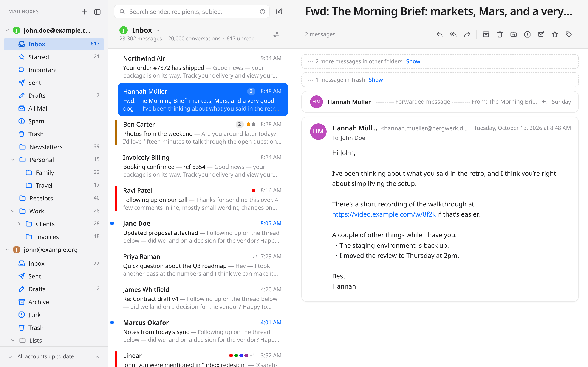
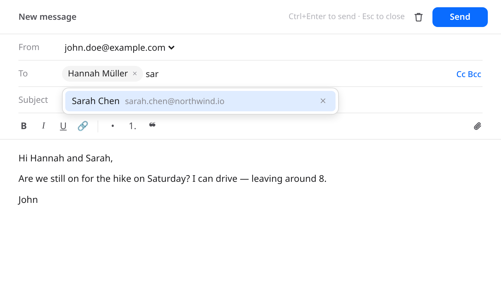
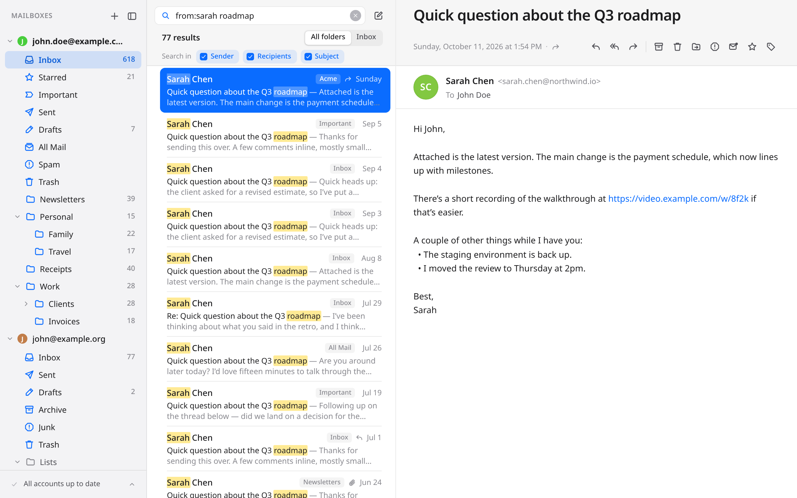
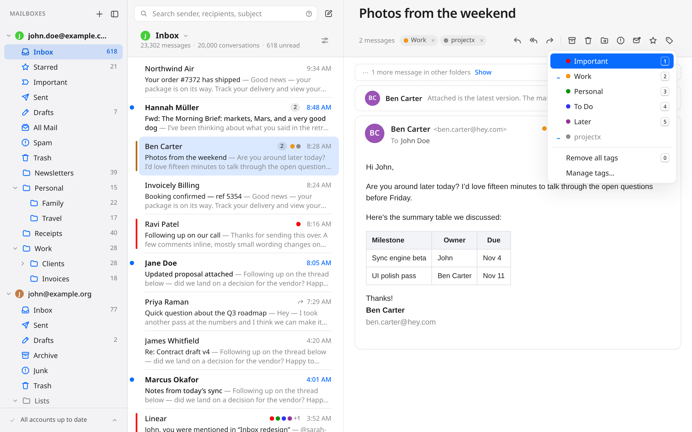
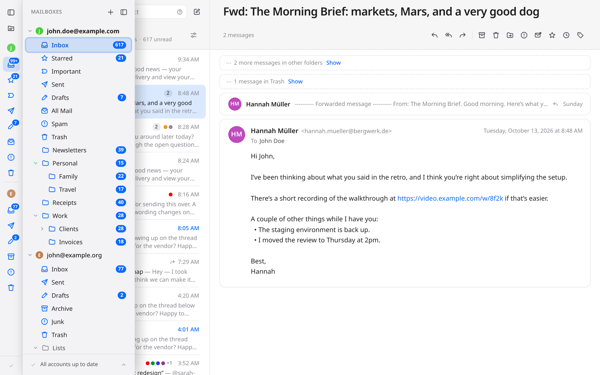
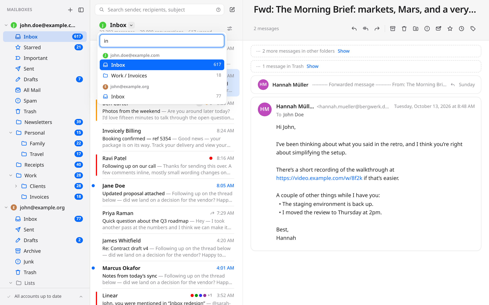
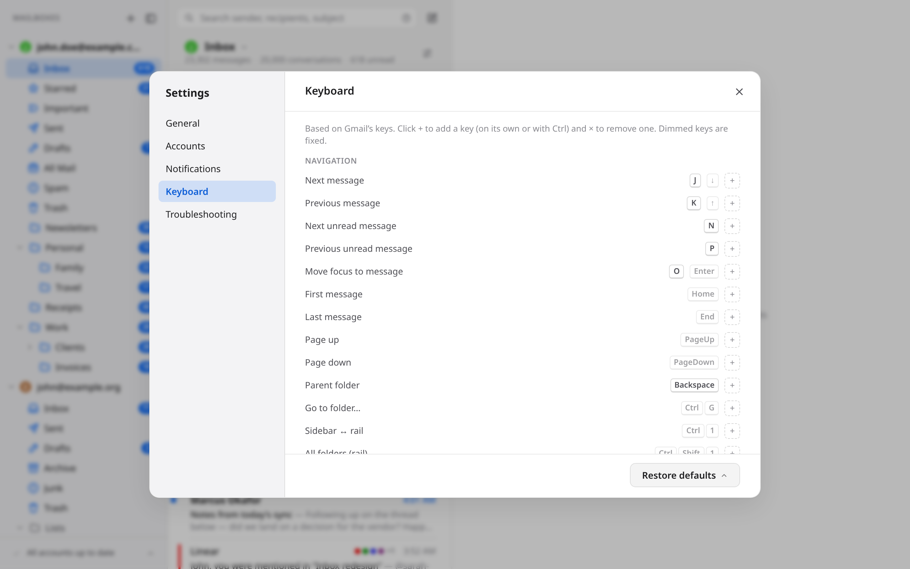
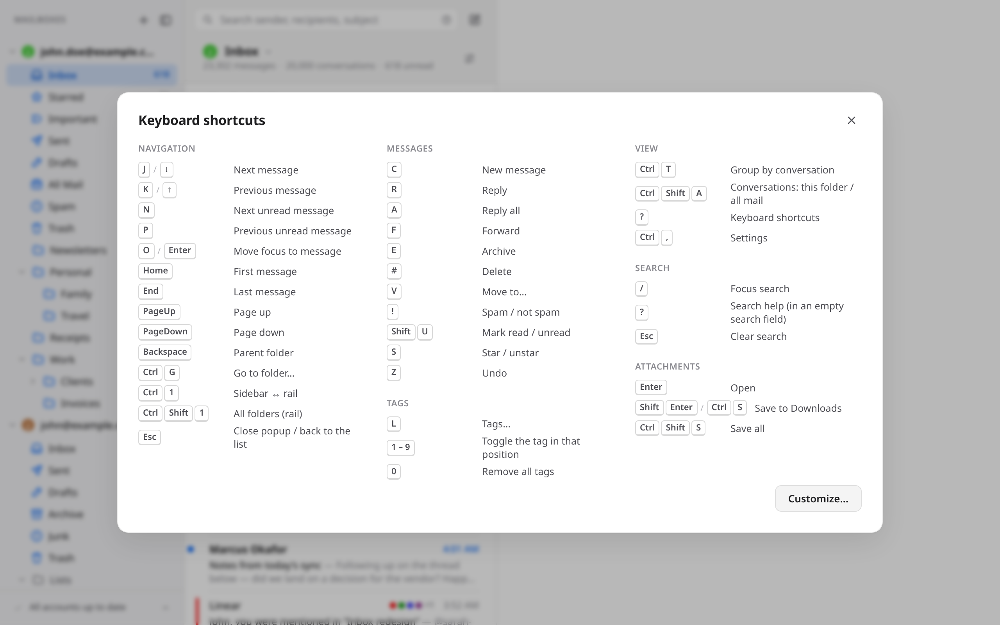

# Email

A fast desktop email app for Linux and macOS. All your accounts in one window, your mail kept
on your computer so everything opens instantly, and a keyboard for everything.

<picture>
  <source media="(prefers-color-scheme: dark)" srcset="docs/screenshots/inbox-dark.png">
  
</picture>

## Download

Get the newest build from the [Latest build](https://github.com/rickhall/email/releases/tag/latest)
page:

- **macOS:** the `.dmg` (Apple Silicon and Intel). Open it and drag Email to Applications.
- **Fedora and other RPM-based Linux:** the `.rpm`, installed with `sudo dnf install ./Email-*.rpm`.
- **Debian, Ubuntu:** the `.deb`, installed with `sudo apt install ./Email_*.deb`.
- **Any other Linux:** the `.AppImage`. Make it executable and run it.

Installing a newer build over an older one upgrades it; your mail and settings stay.

## Adding your accounts

Click **+** in the sidebar and enter your address.

- **Outlook.com, Hotmail and Microsoft 365:** you sign in on Microsoft's own page in your
  browser. Work and school accounts need IMAP allowed by their administrator.
- **Gmail:** use an [app password](https://myaccount.google.com/apppasswords) (it needs
  2-Step Verification turned on), not your Google password.
- **Any other provider:** your address and password. The servers are found for you; if not,
  enter them under **Advanced**.

Passwords and sign-ins are kept in your system's keychain. The first sync downloads your
mail in the background; you can read and write while it runs.

## What it does

**Every account in one window.** Gmail (with its labels), Outlook and any IMAP server side by
side. The list scrolls through tens of thousands of messages without waiting, and new mail
arrives as it's delivered. Conversations are grouped together, even across folders.

**Writing mail** happens in its own window: rich text, attachments by drag and drop, replies
quoted below your text, and a switch between Reply and Reply all. Addresses are suggested from
the people you write to most. Sending waits 10 seconds so you can undo it.

**Search** as you type, over senders, recipients and subjects, in every folder or just the
current one. It understands `from:`, `to:`, `subject:`, `"exact phrases"` and `-exclusions`.

**Tags** work like Thunderbird's and sync with it: press `1`–`9` to tag, and see them as
coloured dots in the list. On Outlook and Microsoft 365 accounts they're Outlook categories,
so Outlook shows them too.

**Snooze** reminds you of a message later: pick a time, or a day on the calendar. The message
stays where it is and comes back to the top of your Inbox, unread, when it's due, on every
computer you use Email on.

**Getting around:** fold the sidebar into a slim rail (Ctrl/⌘+1), or jump to any folder in any
account by typing its name (Ctrl/⌘+G).

**Keyboard first.** Choose Gmail's or Thunderbird's shortcuts in Settings and change any of
them; press `?` to see them all.

**And also:** notifications for new mail, email links from your browser opening a new message
(Settings › General › Make Email the default), your own order and markers for accounts, and
images in messages blocked until you choose to load them.

## Good to know

- **Your mail stays on your computer.** Nothing goes anywhere but your mail servers. It's
  stored in `~/.local/share/dev.mailclient.desktop/` on Linux and
  `~/Library/Application Support/dev.mailclient.desktop/` on macOS.
- **Tags and Snooze on Outlook and Microsoft 365** go through Microsoft Graph, which needs
  your permission once: Settings › Accounts › Tags & snooze › Turn on…. A work or school
  account may need your administrator to allow it first.
- **Something not working?** Settings › Troubleshooting shows the app's log.

## For developers

Building, testing and how it works inside: [docs/DEVELOPING.md](docs/DEVELOPING.md).
