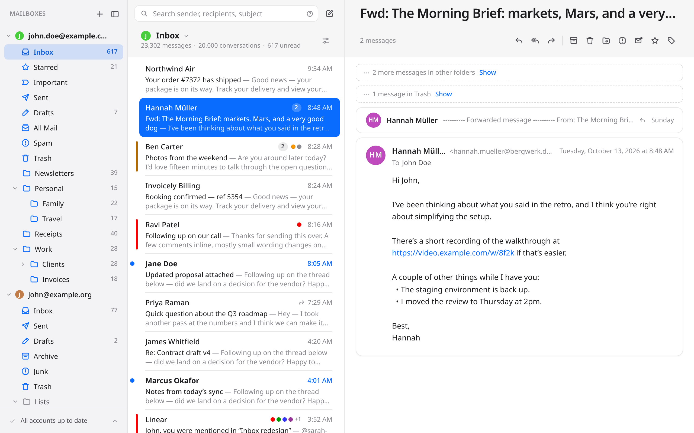
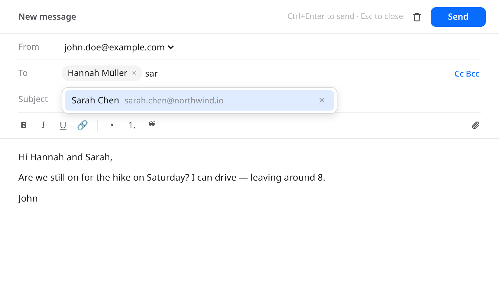
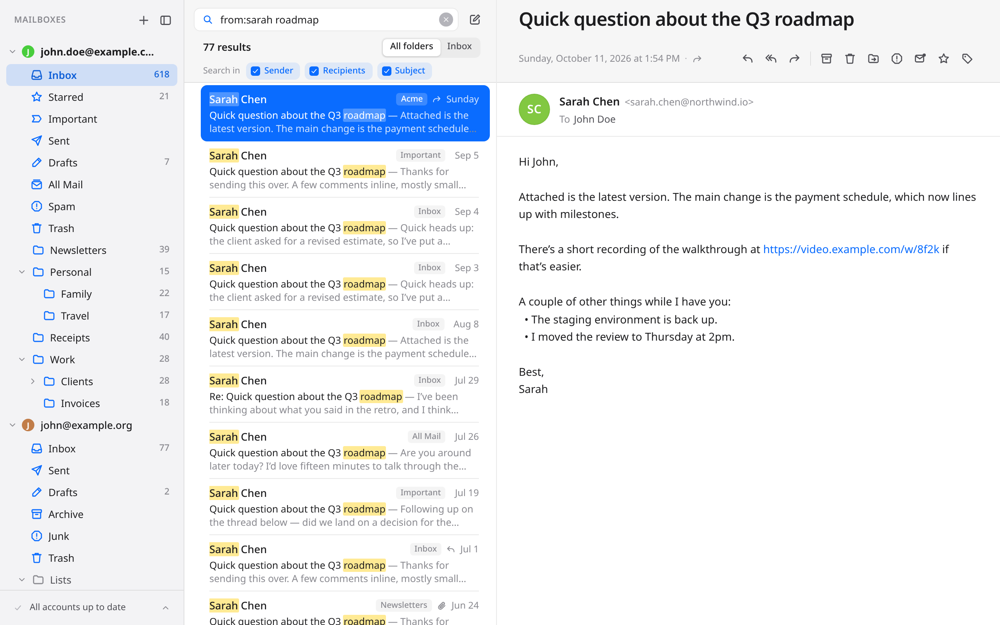
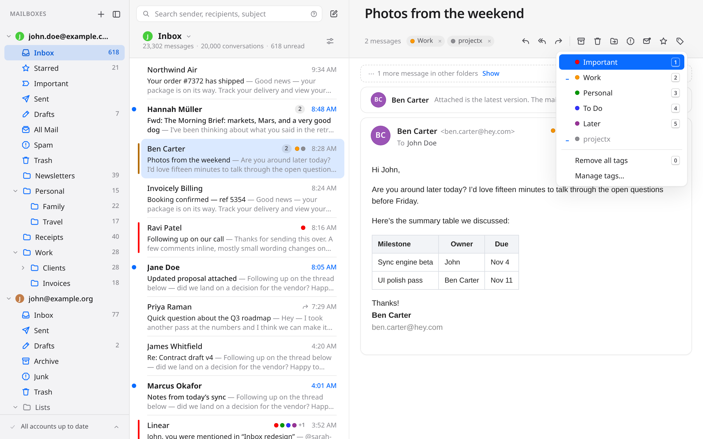
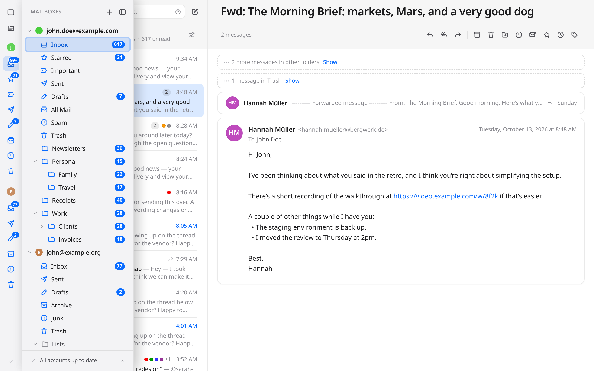
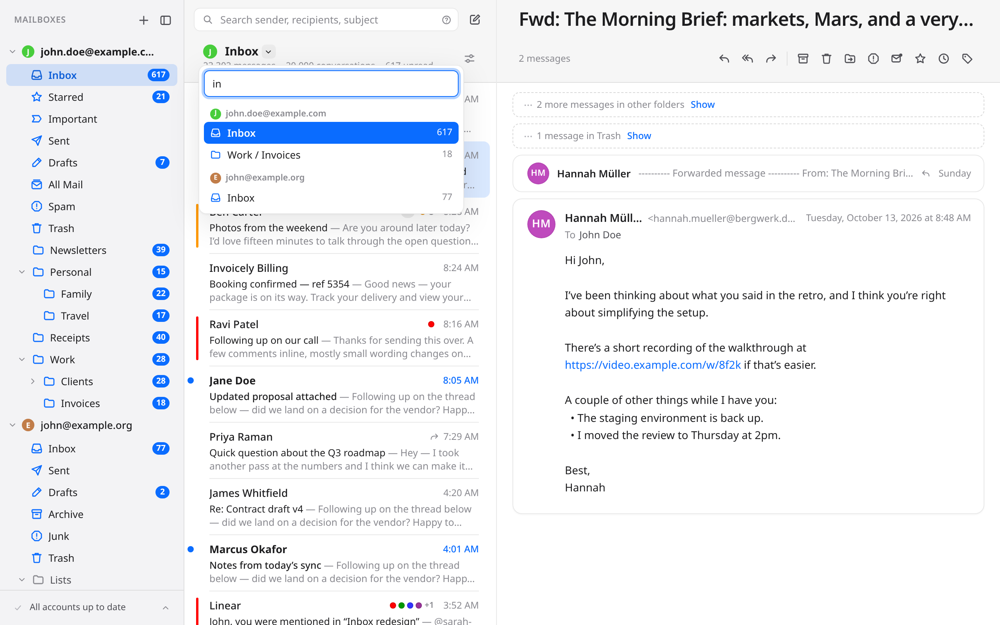
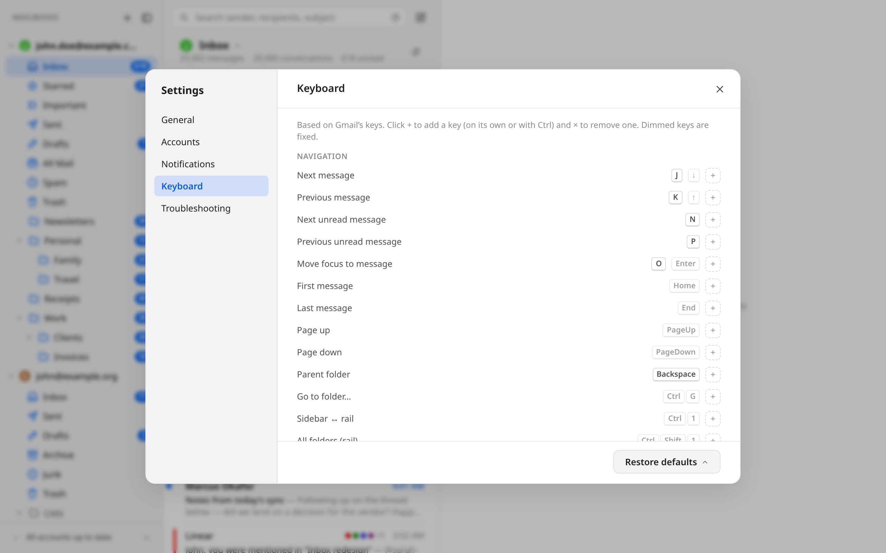
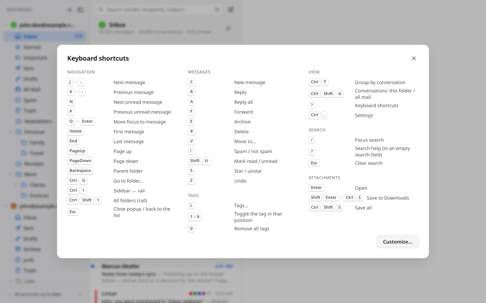

# Email

A fast desktop email app for Linux, macOS and Windows. All your accounts in one window, your
mail kept on your computer so everything opens instantly, and a keyboard shortcut for everything.

<picture>
  <source media="(prefers-color-scheme: dark)" srcset="docs/screenshots/inbox-dark.png">
  
</picture>

## Download

Get the newest build from the [Latest build](https://github.com/rickhall/email/releases/tag/latest)
page:

- **macOS:** the `.dmg` (Apple Silicon and Intel). Open it and drag Email to Applications.
- **Fedora and other RPM-based Linux:** the `.rpm`, installed with `sudo dnf install ./Email-*.rpm`.
- **Debian, Ubuntu:** the `.deb`, installed with `sudo apt install ./Email_*.deb`.
- **Any other Linux:** the `.AppImage`. Make it executable and run it.
- **Windows:** the `-setup.exe` (or the `.msi`). It isn't signed, so Windows SmartScreen asks
  once: More info › Run anyway. To open email links with it, choose Email for "mailto" in
  Settings › Apps › Default apps.

Installing a newer build over an older one upgrades it; your mail and settings stay.

**Updates come by themselves** (if Settings › Troubleshooting › Updates says your copy doesn't
update itself, it's from before updates were turned on: install a newer one by hand once): shortly after Email starts and every six hours it looks for a newer build,
downloads it in the background, and **Restart to update** appears at the bottom of the
sidebar. Settings › Troubleshooting › Updates turns the looking off, or looks now. (The `.deb`
and `.rpm` get updated too, asking for your password.) A copy you build yourself, or one from
a fork without the update signing key (**Updates** in [DEVELOPING](docs/DEVELOPING.md)),
doesn't update itself: install the newer one the same way.

## Privacy and trust

- **Nothing is sent to us.** No analytics, crash reports or usage data, and no account with us.
- **Your mail stays on your computer**, and your passwords are in the system's keychain. Email
  talks to your own mail servers and GitHub (for updates), plus only the services you turn on.
- **Senders can't see that you opened their mail** until you allow its pictures and other web
  content, which are blocked by default. Messages are cleaned of scripts before they're shown.
- **You choose what's looked up.** Sender pictures, Google Contacts, writing help and the rest are
  off until you turn them on, and each says what it contacts.
- **Updates are signed** and checked before they're installed. The code is open, and the builds
  are made from it in public.

The [trust report](docs/TRUST.md) lists every connection Email can make, what it keeps and
where, how you're protected, and the limits worth knowing, with links to the code.

## Adding your accounts

The first time Email starts, it asks for your address. Add more accounts in Settings ›
Accounts › **+ Add account**.

- **Outlook.com, Hotmail and Microsoft 365:** you sign in on Microsoft's own page in your
  browser. Work and school accounts need IMAP allowed by their administrator.
- **Gmail and Google Workspace:** use an [app password](https://myaccount.google.com/apppasswords)
  (it needs 2-Step Verification turned on), not your Google password. Or sign in on Google's
  own page in your browser; Google doesn't list the app as verified yet, so it warns you first
  (**Advanced › Go to …**). A build of your own needs an OAuth client of your own
  ([setup](docs/GOOGLE.md)).
- **Any other provider:** your address and password. The servers are found for you; if not,
  enter them under **Advanced**.

Passwords and sign-ins are kept in your system's keychain. The first sync downloads your
mail in the background; you can read and write while it runs.

## What it does

**Every account in one window.** Gmail (with its labels), Outlook and any IMAP server side by
side. The list scrolls through tens of thousands of messages without waiting, and new mail
arrives as it's delivered. Conversations are grouped together, even across folders.

**Writing mail** happens in its own window: rich text (with colours, highlights, code, code blocks and headings, and
Markdown as you type), pictures pasted into the text,
attachments by drag and drop, replies quoted below your text, and a switch between Reply and
Reply all. Addresses are suggested from the people you write to most. Signatures (Settings ›
Signatures, with pictures pasted in) go under your text, a default per address for new messages
and for replies, switchable in the message. An account can send as other addresses too (an
alias, a catch-all domain's), each with its own name and signatures, one of them the default;
replies go out from the address the mail came to. Sending waits 10 seconds so you can undo it.
Drafts open again with a double-click, including ones written on your phone or in another app.



**Sort and group** the list from the View options: by date received (grouped into Today,
Yesterday, this week's days, last weeks and months), or by sender or recipient, A to Z, with
each person's messages together under their name, or by size, largest first, to find what
takes the space. **Filter** it to unread or read mail, starred, or messages with attachments.
Clicking the unread count above the list shows only unread mail (again: all of it); clicking the
message count shows everything. In Sent and Drafts each message shows who it went to
("To: …"), not you.


**Search** as you type, over senders, recipients, subjects, the text of your mail and its
attachments (their names, and if you turn it on the text in PDFs and plain-text files on
your computer), in every
folder or just the current one, in all of them or only some ("Search in"). It understands
`from:`, `to:`, `subject:`, `body:`, `attachment:`, `"exact phrases"` and `-exclusions`.



**Tags** work like Thunderbird's and sync with it: press `1`–`9` to tag, and see them as
coloured dots in the list. On Outlook and Microsoft 365 accounts they're Outlook categories,
so Outlook shows them too.



**Snooze** reminds you of a message later: pick a time, or a day on the calendar. The message
stays where it is and comes back to the top of your Inbox, unread, when it's due, on every
computer you use Email on.

**Help writing (AI)**, without a subscription: add your own Anthropic API key in Settings › AI,
then ✨ AI in a message (Ctrl/⌘+J) drafts a reply or a new message from a few words, or makes
what you wrote better, shorter, more formal or friendlier, fixes the spelling, or translates it.
You see it first and choose whether to use it.


**An address book** (Ctrl/⌘+Shift+B): the people you keep, with their addresses, phone
numbers, company and notes, synced both ways with Google Contacts if you like
([setup](docs/GOOGLE.md)). With Google Contacts, the sidebar (switched between Mail
and Contacts at its top) shows each account's contacts and its groups (Starred, Family…), and
every contact's groups are on its row. Add someone from the sender panel in one click; they
come first when you type an address.


**Everything from a sender** at a glance: Ctrl/⌘+2 opens a panel beside the message with all
the mail from whoever sent it, in every folder. Select them all (Ctrl/⌘+A) and delete, archive or
move them to a folder at once — the quickest way to clear out a newsletter, or to file all of
someone's mail; the next message opens in its place.


**Message source** (Ctrl/⌘+U or ⌥⌘U, or right-click a message), with questions to Claude
about it: why wasn't this marked as spam, is it genuine, who really sent it.

**AI apps:** let Claude Desktop, Claude Code or another MCP app read, search, draft and tidy
your mail (Settings › AI apps; off until you turn it on; deleting and sending always ask you
first).

**Themes:** Settings › General › Theme: Auto (the system's light or dark), Light, Dark, Paper
(warm paper with a terracotta accent, light or dark with the system), Solarized Light and Solarized Dark.
Messages themselves stay on white, as they were written.

**Sender pictures** beside each message (off until you choose a level in Settings › General;
View options turns them on and off): the person's own photo when they're one of your Google
contacts with one, else their company's logo or website icon, or initials. You choose how far
they go: your contacts' photos only, also companies you write to, or all senders (never for
mail in Spam).

**Several at once:** Ctrl/⌘-click or Shift-click messages in the list (or Ctrl/⌘+A for all of
them) to delete, move, mark or tag them together, or forward them as attachments.

**Getting around:** fold the sidebar into a slim rail (Ctrl/⌘+1), or jump to any folder in any
account by typing its name (Ctrl/⌘+G). Right-click a folder › Add to favorites to keep it at the
top, above the accounts (it stays there while the folders scroll); drag favorites up or down, or
Alt+↑/↓, to change their order. Drag messages onto a folder to move them there (Undo in the message
that follows).




**Keyboard first.** Choose Gmail's or Thunderbird's shortcuts in Settings and change any of
them; press `?` to see them all. In a conversation, Enter moves onto its messages, ↑/↓ go
between them and Enter opens or closes one.




**And also:** notifications for new mail; email links from your browser opening a new message
(Settings › General › Make Email the default); your own order and markers for accounts;
attachments as chips with their names under the sender (click to open, right-click to save or
Save As…; a long list shows three rows and "+N more"); right-click a name in a message to write
to that person or copy their address; images in messages blocked until you choose to load them
(for one message, or always from a sender, or from everyone at their company once you turn that
on). Pictures too wide
for the reader shrink to fit; click one to see it at its actual size. Marking mail as spam or
not spam also teaches your provider's spam filter.

## Good to know

- **Your mail stays on your computer.** It goes nowhere but your mail servers, except what you
  ask for: writing help and questions about a message (to Anthropic, with your own key) and
  Google Contacts sync. Sender pictures, if you turn them on, are looked up from the sender's
  own domain, once; at the "companies you write to" level only for domains where you've written
  to someone or have someone in your address book, so a stranger's mail never makes your
  computer contact them. Your mail is
  stored in `~/.local/share/dev.mailclient.desktop/` on Linux,
  `~/Library/Application Support/dev.mailclient.desktop/` on macOS and
  `%APPDATA%\dev.mailclient.desktop\` on Windows.
- **Check a link before you click it:** point at it and the address it really opens shows at
  the bottom of the message, with the site in bold. If the link's text is an address for one
  site but the link goes to another, or the site's name uses look-alike international letters,
  it says so in red.
- **Tags and Snooze on Outlook and Microsoft 365** go through Microsoft Graph, which needs
  your permission once: Settings › Accounts › Tags & snooze › Turn on…. A work or school
  account may need your administrator to allow it first.
- **Export and remove:** Settings › Accounts › Export… saves an account's mail as mbox files
  (one per folder) that other mail apps import, downloading any attachments first. Remove
  account… deletes what's on this computer; the mail on the server stays.
- **Something not working?** Settings › Troubleshooting shows the app's log.

## For developers

The app is [Tauri 2](https://v2.tauri.app): a Rust core (`crates/mail-core`: sync, storage,
search) and a SolidJS interface (`app/src`), with the desktop shell in `app/src-tauri`. How it
works inside: [docs/DEVELOPING.md](docs/DEVELOPING.md).

### What you need

- **Rust**, stable, through [rustup](https://rustup.rs).
- **Node.js** 24 (with npm).
- **macOS:** Xcode's command line tools (`xcode-select --install`).
- **Linux** (Debian/Ubuntu): `sudo apt install libwebkit2gtk-4.1-dev libappindicator3-dev librsvg2-dev patchelf build-essential`.
- **Windows:** Visual Studio's C++ build tools, WebView2 (part of Windows 11), and
  [NASM](https://www.nasm.us) on the `PATH`.

Then, once:

```sh
cd app
npm install
```

### Run

```sh
cd app
npm run tauri dev    # the desktop app, rebuilt as you change the code
npm run dev          # the interface alone, in a browser (http://localhost:1420), on made-up mail
```

`npm run tauri dev` uses the same accounts and mail as an installed copy (the same data
folder and keychain item), so quit the installed app first. `npm run dev` needs no Rust and
touches nothing real: it runs against an in-memory mock backend (`app/src/mock.ts`), with flags
in the URL for other situations, such as `?empty` (first start) or `?many` (six accounts).

### Build

```sh
cd app
npm run tauri build                     # installers for this system, in target/release/bundle/
npm run tauri build -- --bundles app    # macOS: just Email.app
```

To sign a macOS build with a certificate of your own, set `APPLE_SIGNING_IDENTITY` to its name
first. Without one the app gets no proper signature, and macOS won't show its notifications.
The GitHub workflow (`.github/workflows/build.yml`) builds every system's installers on each push.

With an Apple Developer ID, `scripts/build-mac.sh` does the whole thing on a Mac: builds
Email.app, signs it with your Developer ID Application certificate, has Apple notarize it,
staples the ticket and zips it (`--install` puts it in ~/Applications, `--no-notarize` only
signs). Your certificate's name and notarization credentials (a `notarytool` keychain profile)
go in `scripts/mac-signing.env`, which isn't committed; `scripts/build-mac.sh --help` says how.

### Test

```sh
cargo test --workspace            # the Rust core
cd app && npm run test:unit       # interface logic
cd app && npm run test:ui         # the interface, driven in a browser against the mock
```

### Debug

- **The interface:** Developer Tools are in the View menu (⌥⌘I, or Ctrl+Alt+I), in dev and
  release builds alike.
- **The core:** it logs to the terminal under `npm run tauri dev`, and always to `email.log`
  (`~/Library/Logs/dev.mailclient.desktop/` on macOS, `~/.local/share/dev.mailclient.desktop/logs/`
  on Linux). Set `RUST_LOG` for more, for example `RUST_LOG=debug npm run tauri dev`, or
  `RUST_LOG=mail_core=debug` for the core alone.
- **The data:** `mail.db` and `bodies.db` (SQLite) are in
  `~/Library/Application Support/dev.mailclient.desktop/` on macOS,
  `~/.local/share/dev.mailclient.desktop/` on Linux and `%APPDATA%\dev.mailclient.desktop\` on
  Windows. With the app quit, deleting them makes it start over with no accounts (their
  passwords stay in the keychain until removed there).

### Clean

```sh
cargo clean                  # Rust's build output (target/, which grows to many GB)
rm -rf app/dist              # the interface's built files
rm -rf app/node_modules      # npm's packages (npm install brings them back)
```
